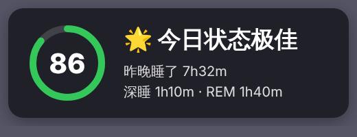

# OBS 遥控（iPhone + Apple Watch）

在 Apple Watch 上查看 OBS 推流数据（码率、网络丢帧、拥塞、CPU、帧率），控制开播/录制/切场景，把手表实时心率推送到 OBS 直播画面，并读取昨晚睡眠生成「今日状态」卡片。



## 架构

```
Apple Watch ──WatchConnectivity──▶ iPhone App ──obs-websocket v5──▶ 电脑上的 OBS
  · 显示状态                        · 每 2 秒采集 GetStats / GetStreamStatus
  · 发送指令                        · 执行指令
  · 测量心率（锻炼会话）            · 心率 → 文字源 + CustomEvent
                                    · 读取「健康」睡眠 → 评分 → 文字源 + CustomEvent
```

watchOS 不允许普通 App 直接使用 WebSocket 等底层网络，所以由 iPhone 负责连接 OBS。

## 目录

| 路径 | 说明 |
|---|---|
| `project.yml` | XcodeGen 配置，用来生成 Xcode 工程 |
| `Shared/` | iPhone 和手表共用的数据模型和格式化 |
| `iOS/` | iPhone App：obs-websocket 客户端、采集、设置界面 |
| `Watch/` | 手表 App：状态页、控制页、心率页 |
| `overlay/heart-rate.html` | OBS 浏览器源用的心率动画叠加层 |
| `overlay/sleep-status.html` | OBS 浏览器源用的「今日状态」睡眠卡片 |

## 编译

需要 macOS + Xcode 16 以上 + [XcodeGen](https://github.com/yonaskolb/XcodeGen)。

```bash
brew install xcodegen
xcodegen generate          # 生成 ObsWatchRemote.xcodeproj
open ObsWatchRemote.xcodeproj
```

1. 在 `project.yml` 里把 `BUNDLE_ID_PREFIX` 改成你自己的（例如 `com.yourname`），重新 `xcodegen generate`。
2. 把 `Config/Signing.local.xcconfig.example` 复制为 `Config/Signing.local.xcconfig`，填上你的 Team ID（Xcode → Settings → Accounts 可查看），然后重新 `xcodegen generate`。这个文件已被 gitignore，不会提交。
3. 选 `ObsRemote` scheme，目标选你的 iPhone，运行。手表 App 会随 iPhone App 一起安装（也可以在 iPhone 的「Watch」App 里手动安装）。

## OBS 设置

1. OBS 28 以上 → 工具 → WebSocket 服务器设置 → 勾选「开启 WebSocket 服务器」，记下端口（默认 4455）和密码。
2. iPhone 与电脑在同一局域网，App 里填电脑 IP、端口、密码，点连接。首次会弹「本地网络」权限，选允许。
3. 心率显示，下面两种方式二选一（也可以都用）：
   - 文字：在 OBS 新建一个「文本」源，名称与 App 里的「心率源名称」一致（默认 `HeartRate`）。App 会直接改这个文本源的文字。
   - 动画：用下面第 4 步的浏览器源。浏览器源**不要**填进 App 的「心率源名称」；只用动画时，把 App 里的「心率源名称」清空即可。
4. 心率动画（可选）：新建「浏览器」源（名称随意，例如 `心率动画`） → 勾选「本地文件」选择 `overlay/heart-rate.html`；如果 WebSocket 有密码，改为不勾本地文件、URL 填
   `file:///完整路径/overlay/heart-rate.html?password=你的密码`。宽 400，高 160。

5. 睡眠状态（可选）：
   - 文字：新建「文本」源，命名为 `SleepStatus`。
   - 卡片：新建「浏览器」源，URL 填 `file:///完整路径/overlay/sleep-status.html?password=你的密码&show=30`，宽 520，高 200。`show=30` 表示弹出 30 秒后淡出，不填则一直显示。

## 使用

- 手表上下滑动切换三页：**状态** / **控制** / **心率**。
- 心率页点「开始推送心率」会开启一次锻炼会话（不会保存到「健身」记录），iPhone 端随即开始把心率写入 OBS。
- 睡眠：iPhone App 打开时自动读取「健康」中昨天 18:00 之后的睡眠记录。连上 OBS 时会推送一次，之后每分钟静默重发（卡片不会重复弹出）；在手表控制页点「推送睡眠状态」可以手动再弹一次。
  - 评分是本 App 自定义的（不是 Apple 官方睡眠分）：时长 50 分（7.5 小时满分）、深睡与 REM 占比 25 分、睡眠效率 25 分。≥85 状态极佳，≥70 状态不错，≥55 状态一般，其余为需要休息。
  - 文字格式可在 App 里改，占位符：`{emoji} {label} {score} {duration} {deep} {rem}`。
- 指标颜色：绿色正常，黄色注意，红色异常。
  - 网络：丢帧率 > 0.1% 或拥塞 > 15% 为黄，丢帧率 ≥ 1%、拥塞 ≥ 50% 或正在重连为红。
  - CPU（OBS 进程）：≥ 60% 黄，≥ 85% 红。

## 已知限制

- iOS 会在 App 退到后台后很快断开网络。直播时让 iPhone App 停留在前台（默认开启屏幕常亮），建议接电源。
- 码率是用两次采样的已发送字节数差值算出来的，每 2 秒刷新一次。
- 密码存放在 UserDefaults，仅适合个人使用。
